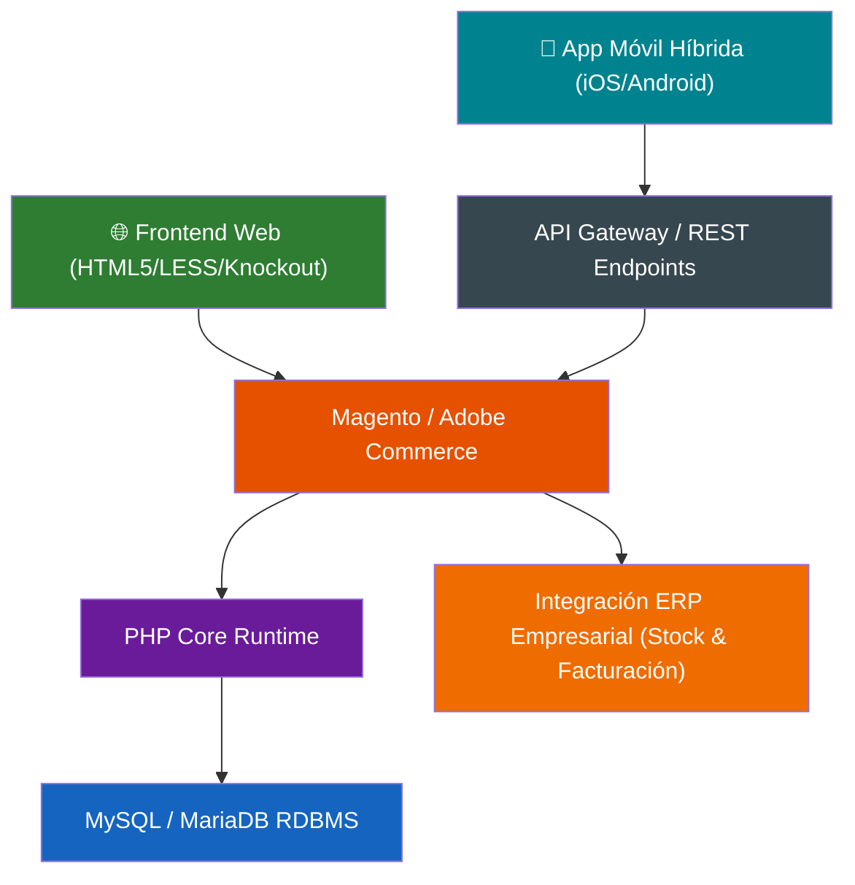
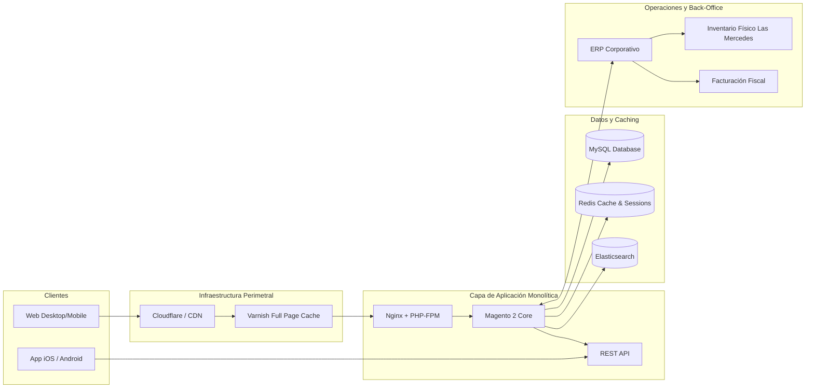

# 🔍 Análisis Técnico Profundo: licoresmundiales.com

---

## 1. ¿De Qué Trata la Empresa?

**Licores Mundiales** es una empresa comercial venezolana fundada en **1973** como negocio familiar en **Plaza Venezuela, Caracas**. Se especializa en la **importación, distribución y venta al detal y mayor de vinos, destilados y licores premium**.

### Hitos Históricos

| Año | Hito Clave |
|------|-----------|
| **1973** | Fundación como tienda familiar en Plaza Venezuela, Caracas. |
| **2001** | Lanzamiento de una de las primeras páginas web con catálogo en línea del sector licorero en Venezuela. |
| **2006** | Inauguración de la sede insignia en la **Av. Río de Janeiro, Las Mercedes** — consolidada como la tienda especializada en vinos y licores más grande del país. |
| **2016** | Formalización e inauguración de su plataforma moderna de e-commerce transaccional. |
| **2020** | Lanzamiento de la **primera aplicación móvil especializada en licores en Venezuela** (iOS y Android). |

### Modelo de Negocio y Operación

- **Tienda física insignia:** Espacio comercial de gran formato en Las Mercedes con salones de cata y asesoría personalizada.
- **Canal Digital E-commerce:** Catálogo en línea con más de **2,000 etiquetas** de vinos del viejo y nuevo mundo, whiskies (Single Malts, Blends, Bourbons), rones venezolanos con D.O.C., tequilas, vodkas, ginebras y aperitivos.
- **Logística Urbana:**
  - **Delivery same-day:** Entregas en Caracas en el mismo día para órdenes confirmadas antes de las 18:00 hrs.
  - **Click & Collect (Pick-up):** Retiro directo en sede Las Mercedes en menos de 60 minutos.
- **Orquestación de Pagos Multimoneda:** Adaptado a la realidad financiera de Venezuela (Zelle, Pago Móvil interbancario, transferencias bancarias nacionales, PayPal, tarjetas de crédito internacionales y efectivo en divisas/moneda local).
- **Cultura Organizacional:** Reconocimiento con la certificación internacional **Great Place to Work**.

---

## 2. Stack Tecnológico de la Plataforma Actual

### Plataforma Principal

### Desglose Tecnológico Detallado

| Componente | Tecnología Detectada | Rol y Función |
|------------|---------------------|---------------|
| **Core E-commerce** | **Magento (Adobe Commerce)** | Plataforma monolítica de comercio electrónico empresarial para gestión de catálogos y órdenes. |
| **Lenguaje Backend** | **PHP** | Ejecución en servidor, controladores, bloques de layout y lógica de negocio. |
| **Almacenamiento** | **MySQL / MariaDB** | Base de datos relacional con esquema EAV (Entity-Attribute-Value) propio de Magento. |
| **Servidor Web** | **Nginx / Apache** | Proxy reverso, terminación SSL y despacho de peticiones PHP-FPM. |
| **Frontend Runtime** | **Knockout.js / RequireJS** | Librerías JavaScript integradas en la arquitectura frontend tradicional de Magento 2. |
| **Preprocesador CSS** | **LESS** | Estilos compilados del tema Magento base. |
| **Búsqueda y Filtros** | **Elasticsearch / OpenSearch** | Motor de indexación y navegación por facetas (layered navigation). |
| **Capa de Aceleración** | **Redis & Varnish Cache** | Almacenamiento en memoria para sesiones y full-page caching. |
| **Aplicación Móvil** | **Híbrida (Cordova/Ionic/Flutter)** | App para iOS y Android sincronizada con la base de datos de órdenes y productos. |
| **Integración ERP** | **Middleware propio / Web services** | Sincronización continua de stock físico con almacén central, inventario y facturación legal. |

### Proveedor de Desarrollo

El desarrollo de la plataforma y su ecosistema móvil fue ejecutado por **LogosCorp**, agencia internacional de transformación digital y comercio electrónico, quienes lo posicionan como caso de estudio exitoso de integración ERP y despliegue omnicanal.

---

## 3. Arquitectura del Sistema Actual

---

## 4. Indicadores y Evidencias Técnicas

1. **Rutas multimedia canónicas:** Rutas `/media/catalog/product/` expuestas directamente en la carga de imágenes, firma inequívoca de la estructura de ficheros de Magento.
2. **Navegación por Atributos (Layered Navigation):** Parámetros URL basados en identificadores de atributo típicos del catálogo EAV de Magento.
3. **Módulos Frontend:** Presencia de bundles `requirejs-config.js` y componentes Knockout para bindings de carrito y minicart.
4. **Mecanismos de Protección:** Form keys únicos por sesión inyectados en formularios de checkout y login.

---

## 5. Metodología de Construcción Empleada

El proyecto fue abordado mediante un modelo de **Transformación Digital Empresarial**:
- **Fase 1: Relevamiento y Mapeo:** Análisis del catálogo de más de 2,000 referencias y diseño del modelo de sincronización con el ERP físico.
- **Fase 2: Arquitectura Monolítica:** Despliegue de Magento parametrizando listas de precios, categorías especializadas (Añadas, Denominaciones de Origen, Tipos de Barrica) y reglas de envío por zonas de la Gran Caracas.
- **Fase 3: Pasarelas Locales y Multidivisa:** Construcción de módulos ad-hoc para conciliar pagos en bolívares (Pago Móvil) junto a métodos internacionales (Zelle, tarjetas foráneas).
- **Fase 4: Expansión Móvil:** Empaquetado y publicación de la aplicación móvil para retención y fidelización de clientes recurrentes.
- **Fase 5: Soporte y Optimización:** Mantenimiento preventivo de parches de seguridad de Magento y escalamiento en temporadas de alta demanda (diciembre, fechas festivas).
