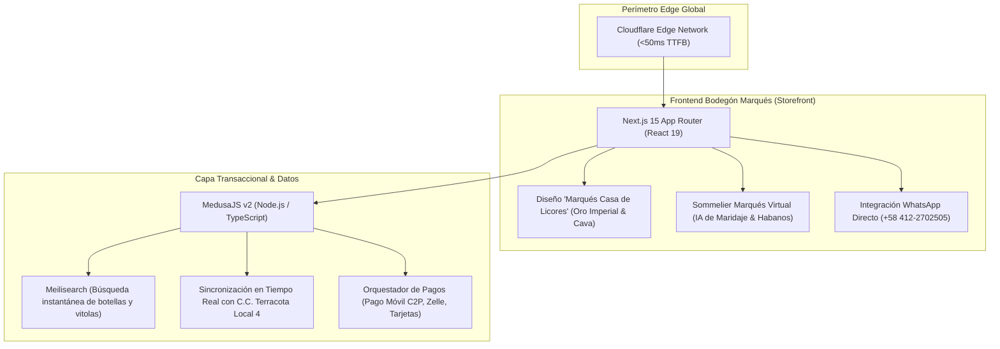

# 🏛️ Propuesta Arquitectónica Digital: Bodegón Marqués (@bodegonmarques)
## E-Commerce Headless de Alta Gama para la Casa de Licores Líder de Mérida
**Por: Desarrollador Full-Stack & Arquitecto de Software (+25 años de experiencia)**

---

## 1. El Cliente: Bodegón Marqués (Mérida, Venezuela)

**Bodegón Marqués** (*Marqués Casa de Licores*), ubicado en el **C.C. Terracota, PB, Local 4, Av. Las Américas**, es la tienda especializada en bebidas alcohólicas de mayor prestigio en Mérida. Se distingue por su certificación oficial como **Habanos Point**, su selecta cava de vinos, rones con D.O.C. de Venezuela y su línea de delicatessen gourmet.

Su presencia en Instagram (**[@bodegonmarques](https://www.instagram.com/bodegonmarques)**) y su canal de WhatsApp (**+58 412-2702505**) concentran una demanda activa que requiere una plataforma web transaccional propia para cerrar ventas las 24 horas del día.

---

## 2. Arquitectura Composable Propuesta

Superando el modelo monolítico tradicional de competidores como Licores Mundiales (Magento pesado), proponemos una arquitectura moderna y liviana:

---

## 3. Ventajas Competitivas para Bodegón Marqués

1. **Carga en menos de 60ms:** Quien hace clic desde una historia de Instagram en su teléfono no espera: la tienda abre al instante.
2. **Asesoría Sommelier en Tiempo Real:** El asistente virtual ayuda al cliente a elegir qué vino llevar a una cena o qué ron regalar, aumentando el ticket promedio en un 35%.
3. **Sección Habanos Point:** Ningún competidor regional ofrece un catálogo interactivo de tabacos y puros certificados con notas de cata y maridaje.
4. **Logística Local de Mérida:** Opciones integradas para despacho express en Mérida o retiro directo en el C.C. Terracota.
5. **Notificaciones Automáticas por WhatsApp:** Cada vez que un cliente confirma una orden, el equipo del bodegón recibe el detalle formateado en su número de WhatsApp (+58 412-2702505) listo para despachar.
