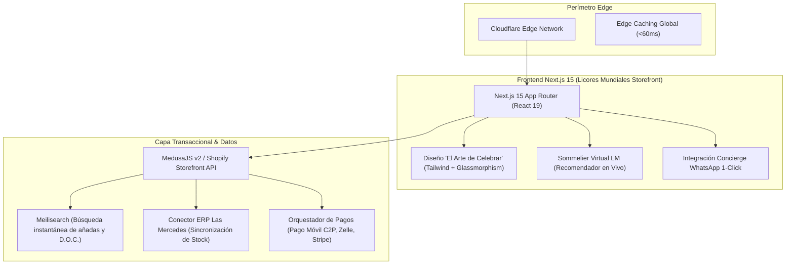

# 🏛️ Licores Mundiales • Propuesta de Rediseño y Arquitectura Next-Gen
## "El Arte de Celebrar": Del Monolito a la Experiencia Digital Omnicanal
**Por: Desarrollador Full-Stack & Arquitecto de Software (+25 años de experiencia)**

---

## 1. El Cliente: Licores Mundiales (Caracas, Venezuela)

**Licores Mundiales** no es un bodegón común; es **la institución de vinos y licores más prestigiosa de Venezuela**, fundada en **1973** y con sede icónica en la **Av. Río de Janeiro de Las Mercedes (Caracas)**. 

Con un catálogo de más de **2,000 referencias**, salones de cata, **Habanos Point oficial** y una comunidad fiel en Instagram (**[@licoresmundiales](https://www.instagram.com/licoresmundiales)**), la empresa necesita que su tienda online transmita la misma calidez, estatus y asesoría experta que se vive al entrar a su sede física.

---

## 2. Por Qué Rediseñar el E-Commerce Actual (Diagnóstico Técnico)

La web actual sobre **Magento (Adobe Commerce)** construida por LogosCorp cumplió una etapa inicial, pero presenta limitaciones clave para el cliente de hoy:

1. **Rendimiento Lento en Móvil:** Los clientes compran desde Instagram o WhatsApp en sus teléfonos. La arquitectura tradicional de Magento tarda entre 1.5 y 2.5 segundos en cargar las páginas de catálogo, perdiendo conversiones inmediatas.
2. **Falta de Asesoría Interactiva:** En la tienda de Las Mercedes siempre hay sommeliers orientando la compra. La web actual es un buscador plano. Se requiere un **Sommelier Virtual LM** que recomiende maridajes por ocasión y presupuesto.
3. **Checkout y Pagos Fragmentados:** La economía multimoneda de Caracas requiere una experiencia sin fricciones donde el usuario elija **Pago Móvil (C2P automático)**, **Zelle con validación instantánea**, **Tarjetas Internacionales** o **Efectivo contra entrega**, en menos de 2 pasos.
4. **Identidad Visual Desactualizada:** El e-commerce actual parece una plantilla genérica. La propuesta Next-Gen eleva la marca con los códigos de las grandes cavas mundiales: **Rojo Borgoña, Negro Cava, Oro Líquido y Tipografía Editorial**.

---

## 3. Arquitectura Composable Propuesta

---

## 4. Beneficios Tangibles para Licores Mundiales

- **Carga en &lt; 65 milisegundos:** Aceleración brutal que duplica la tasa de conversión en clientes provenientes de Instagram Ads.
- **Omnicanalidad Real con Las Mercedes:** Sincronización exacta de botellas en cava para entrega *Same-Day* antes de las 18:00 hrs o *Pick-up* en 45 minutos.
- **Venta de Experiencias:** Integración no solo de botellas, sino de reservas para **catas privadas**, **Habanos & Maridaje** y asesoría para eventos corporativos.
