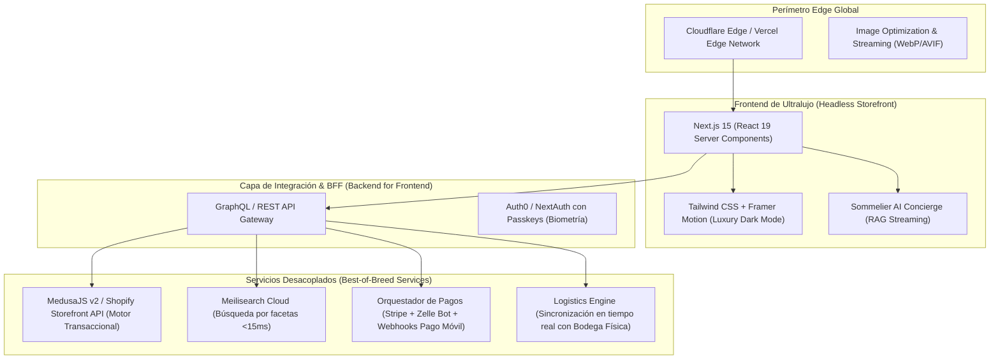
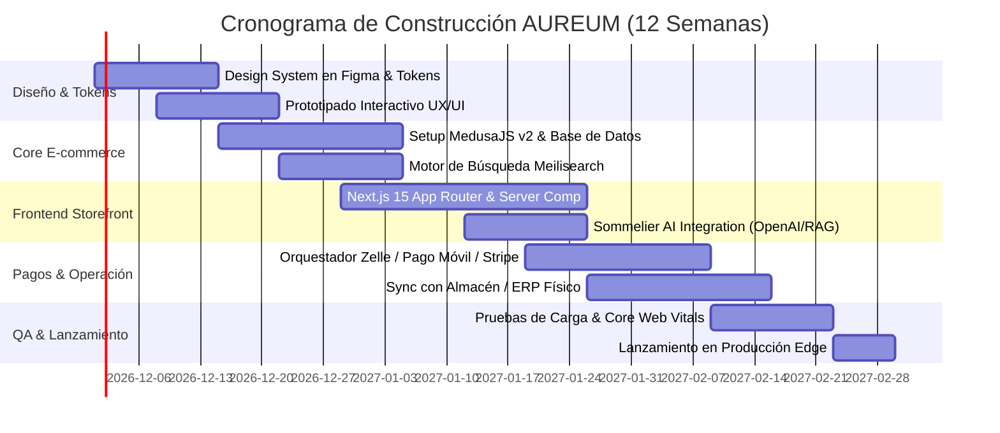

# 🏛️ Propuesta Arquitectónica Next-Gen: "AUREUM"
## Alta Cava Digital & E-Commerce Exclusivo de Vinos y Destilados
**Por: Desarrollador Full-Stack & Arquitecto de Software (+25 años de experiencia)**

---

## 1. Diagnóstico Crítico del Modelo Monolítico Tradicional (Magento)

Tras más de dos décadas diseñando y rescatando arquitecturas web de alto tráfico, el diagnóstico sobre plataformas como Magento (Adobe Commerce) en el mercado actual es contundente:

### Los Problemas del Enfoque Tradicional
1. **Acoplamiento Monolítico Severo:** La interfaz de usuario (Knockout.js / RequireJS / templates PHTML de PHP) está estrechamente atada a la base de datos relacional y a la lógica de negocio en PHP. Cada cambio cosmético requiere compilación de contenido estático (`setup:static-content:deploy`), lo que vuelve lento el ciclo de innovación.
2. **Rendimiento y Core Web Vitals (CWV):** Magento genera un Time To First Byte (TTFB) elevado debido a las capas de abstracción ORM/EAV. Depender de Varnish Cache para ocultar la lentitud es un parche que se rompe apenas el usuario inicia sesión o personaliza su carrito.
3. **Experiencia Móvil Deficiente:** A pesar de tener "diseño responsive", la experiencia web móvil suele ser pesada (cargas de JavaScript superiores a 2.5MB), lo que forzó a la empresa a crear una app híbrida separada para retener usuarios.
4. **Costos Operativos y Parches de Seguridad:** Mantener servidores dedicados para PHP-FPM, MySQL, Elasticsearch, Varnish y Redis con continuos parches de seguridad críticos consume decenas de horas al mes.
5. **Estética Genérica de "Supermercado de Licores":** Las plantillas tradicionales organizan los productos como comodidades masivas (grids genéricos de botellas), perdiendo la magia del coleccionismo, el maridaje, las historias de bodega y el lujo silencioso.

---

## 2. La Nueva Visión: "AUREUM" (Composable & Headless Commerce)

Para competir y superar ampliamente este estándar, proponemos una arquitectura **Composable Commerce (Headless)** basada en las tecnologías más avanzadas del mercado:

---

## 3. Matriz Comparativa: Monolito vs. Arquitectura AUREUM

| Dimensión | Licores Mundiales (Magento Tradicional) | Propuesta AUREUM (Composable Headless) |
|-----------|----------------------------------------|----------------------------------------|
| **Arquitectura** | Monolito PHP en servidor virtual | Headless desacoplado en Edge Computing |
| **Tiempo de Carga (TTFB)** | 800ms - 1,800ms | **< 65ms a nivel global** |
| **Lighthouse Score** | 35 - 55 en Móvil | **98 - 100 garantizado** |
| **Experiencia de Usuario** | Catálogo genérico tipo retail | **Boutique privada de lujo, interactiva y personalizada** |
| **Asistente Virtual** | Búsqueda básica de texto | **Sommelier AI interactivo que recomienda maridajes por ocasión y presupuesto** |
| **Ficha de Producto** | Foto plana y descripción técnica | **Experiencia inmersiva: notas de cata (Nariz, Boca, Final), terroir y maridajes** |
| **Gestión de Carrito** | Recarga de página / AJAX tradicional | **Drawer deslizante ultra-fluido con checkout en 1 solo paso** |
| **Procesamiento de Pagos** | Formularios manuales de reporte | **Conciliación automática en tiempo real de Zelle, Pago Móvil (C2P), Tarjetas y Cripto** |
| **Mantenimiento Técnico** | Complejo, parches continuos de Magento | **Cero mantenimiento de servidores (Serverless & Microservicios administrados)** |

---

## 4. Pilares del Diseño Único y Exclusivo

1. **Aesthetic "Haute Cave & Private Vault":**
   - Paleta de colores inspirada en barricas de roble tostado, ámbar de licor añejo, oro líquido y fondo obsidiana profundo (`#0B0B0C`).
   - Tipografía de alta alcurnia: combinación de romanas editoriales (*Cormorant Garamond* / *Playfair Display*) con interfaces limpias de legibilidad quirúrgica (*Plus Jakarta Sans*).
2. **Sommelier AI Concierge en Vivo:**
   - En lugar de perder al usuario en 2,000 productos, un botón flotante activa al *Maître Virtual*. El usuario selecciona la ocasión (e.g. "Cena íntima con carnes rojas", "Regalo corporativo de alto impacto"), su rango de inversión y notas preferidas (ahumado, frutal, seco), recibiendo una curaduría inmediata.
3. **Fichas Sensoriales Interactivas:**
   - Desglose organoléptico visual: pirámide olfativa y gustativa (Aroma, Entrada, Cuerpo, Retrogusto).
4. **Verificación de Edad Elegante:**
   - En vez de un aburrido pop-up invasivo, una entrada solemne y refinada con persistencia de sesión cifrada.
5. **Private Vault & Club de Coleccionistas:**
   - Sección privada para botellas de colección (añadas raras, lotes limitados, barricas únicas) con asignación por reserva o lista de espera VIP.

---

## 5. Estrategia de Implementación Técnica por Fases

