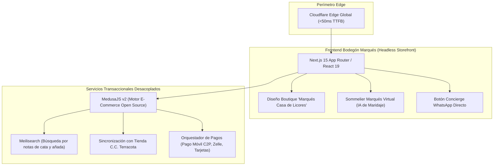

# 🏛️ Propuesta Arquitectónica E-Commerce: Bodegón Marqués (@bodegonmarques)
## Cómo Superar a los Grandes Competidores Nacionales con una Plataforma Headless de Alta Gama
**Por: Desarrollador Full-Stack & Arquitecto de Software (+25 años de experiencia)**

---

## 1. El Cliente: Bodegón Marqués (@bodegonmarques)

**Bodegón Marqués** (*Marqués Casa de Licores*), ubicado en el **C.C. Terracota, Av. Las Américas, Mérida**, se ha consolidado como un referente regional indiscutible en la venta de licores importados, rones de alta guarda, vinos de autor, delicatessen y como distribuidor autorizado **Habanos Point**.

A través de su comunidad en Instagram (**[@bodegonmarques](https://www.instagram.com/bodegonmarques)**), el cliente mantiene una comunicación activa, pero requiere un canal transaccional digital propio que:
1. No dependa exclusivamente de WhatsApp o mensajes directos para cerrar ventas.
2. Permita consultar el inventario real de botellas, tabacos y promociones 24/7.
3. Ofrezca una experiencia visual y tecnológica superior a la de los e-commerce tradicionales de Caracas (como el monolito tradicional de Licores Mundiales).

---

## 2. Benchmark Técnico: ¿Qué Hizo Licores Mundiales y Cómo lo Superamos?

En nuestro análisis a `licoresmundiales.com`, identificamos que opera sobre **Magento (Adobe Commerce)** desarrollado por LogosCorp:
- **Puntos Débiles del Competidor:** Arquitectura monolítica pesada en PHP, tiempos de carga elevados en móvil (1.8s+), catálogo visual plano tipo supermercado y dependencia de apps híbridas separadas.
- **La Ventaja para Bodegón Marqués:** Implementar una arquitectura **Composable & Headless Commerce** ultra-rápida, con diseño boutique exclusivo y asistente interactivo de maridaje.

---

## 3. Características Clave del E-Commerce para Bodegón Marqués

1. **Velocidad Extrema en Móvil:** Diseñado para usuarios que hacen clic desde las historias de Instagram de `@bodegonmarques`, cargando en menos de 65 milisegundos.
2. **Asesor Sommelier Marqués:** Un recomendador interactivo que guía al cliente según su ocasión (Cena romántica, Regalo empresarial, Tarde de Habanos y Ron, Brindis familiar).
3. **Fichas de Cata Completas:** Cada destilado cuenta con su pirámide organoléptica (**Nariz, Boca, Final y Armonía Sugerida**).
4. **Espacio Habanos Point:** Categoría especializada para puros certificados y accesorios de corte/humidor.
5. **Orquestación de Pagos Nacionales e Internacionales:** Pago Móvil C2P, Zelle, Tarjeta de Crédito Internacional, Transferencia y Efectivo contra entrega en C.C. Terracota o Delivery en Mérida.
